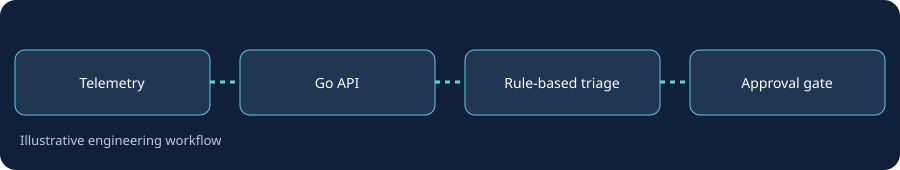
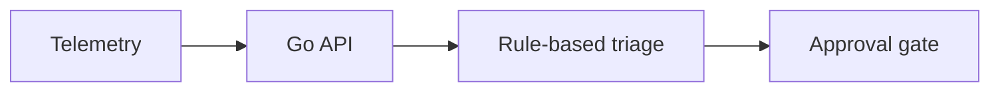
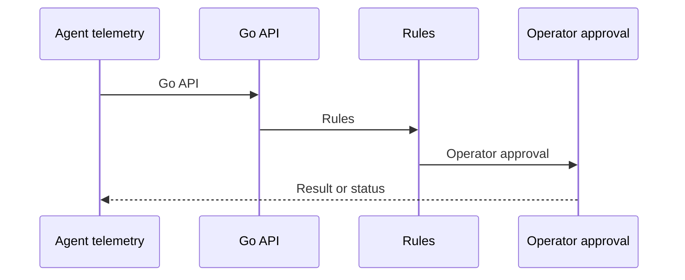

# CloudSentinels

<!-- portfolio-visual-start -->
## Engineering overview

 





Illustrative workflow: Telemetry → Go API → Rule-based triage → Approval gate. Not live telemetry or proof of production integration.

[Developer profile](https://github.com/ABHILASH9519) · [Issues](https://github.com/ABHILASH9519/cloudsentinels/issues)
<!-- portfolio-visual-end -->


**A Go-first cloud and Kubernetes observability platform with a React dashboard, explainable incident triage and approval-gated response workflows.**

Go owns the cluster inventory/monitoring API, explainable cluster analysis, Kubernetes agent and a standalone Lambda adapter. The React/TypeScript frontend is the presentation layer. The currently deployed AWS Operations Lambda still serves persistent incident/alert/profile routes, and supporting EventBridge/SQS/Zapier workers remain Node.js; porting those deployed handlers into Go is a remaining migration task.

> **Latest local and AWS verification (15 Nov 2026):** Docker Desktop Kubernetes and the Minikube profile `cloudsentinels-local` each have one Ready node; both isolated Go agents are sending telemetry to the Go API in read-only mode. The pinned n8n 2.16.1 container is healthy and the persisted 15-node unified workflow is active. Local Go race tests, vet, frontend checks/build, serverless processor/worker tests, CloudFormation lint, and the Linux ARM64 Go Lambda build pass. In AWS, the `cloudsentinels-n8n-bridge` stack is `CREATE_COMPLETE` in `ap-south-1`; `cloudsentinels-aws-server-monitor` is `CREATE_COMPLETE` in `eu-north-1`; both existing Node.js Lambda functions are Active and the automation SQS event-source mapping is enabled. Six messages are waiting in the dedicated AWS-to-n8n queue. **Not yet production-ready:** Firebase Web/Admin credentials are missing, so API `/readyz` correctly returns 503. The EC2 server is stopped. EKS is not provisioned. The Go Lambda adapter is built but not deployed. The local AWS CLI is authenticated as root; the poller correctly refuses root, and the existing SQS consumer policy is unattached, so AWS events are not yet being consumed by local n8n.

## Features

- **Cluster inventory:** 20 sanitized cluster records loaded from the checked-in Airtable snapshot; optional server-side Airtable API refresh.
- **Monitoring:** normalized cluster health, node/pod counts, reported CPU/memory and agent telemetry freshness.
- **Explainable AI triage:** deterministic rules inspect cluster health, CPU, state and missing telemetry; findings include evidence, confidence and recommended checks.
- **Kubernetes agent:** Go desktop/in-cluster agent collects node, pod, warning-event and resource metrics; approved deployment restart/rollback is restricted by the agent action and namespace allowlists.
- **Unified automation:** one local n8n workflow classifies Kubernetes, EC2, Lambda and supported security events into the same incident lifecycle and remediation runbook. HMAC-signed Go API events and Zapier notifications remain separate destinations.
| Offline/local Kubernetes | Minikube profile cloudsentinels-local plus Go agent | Running; 1 Ready node, 9/9 healthy pods; read-only by default, mutations disabled |
- **Security controls:** Firebase ID-token validation, per-cluster agent credentials, CORS allowlist and signed approval gates for mutations. The local startup script fails closed until matching Firebase Web App and Admin credentials are configured.

## Architecture

```text
React + TypeScript dashboard
          |
          | authenticated HTTPS / local development API
          v
       Go HTTP API  <------> Airtable inventory adapter
          |
          +------> Monitoring summary + explainable analysis
          |
          +------> HMAC-signed Zapier notifications / commands
          |
          +<----- Go Kubernetes agent (outbound polling + telemetry)
          |
          +------> API Gateway / AWS Lambda adapter
          +------> Signed event dispatch to local n8n workflow

AWS EventBridge / SQS --> local poller --> same n8n workflow
```

| Runtime | Purpose | Current status |
|---|---|---|
| Online server | Go API, inventory, monitoring, analysis and command broker | Running locally; EC2 server-monitor stack deployed in eu-north-1; instance stopped |
| Online serverless | Existing Node.js Operations API and Automation Processor; separate Go Lambda adapter | Both Node.js Lambdas Active in ap-south-1; SQS event-source mapping enabled; Go Lambda ARM64 build passes but adapter is not deployed |
| Offline/local Kubernetes | Minikube profile cloudsentinels-local plus Go agent | Running; 1 Ready node, 9/9 healthy pods; read-only by default, mutations disabled |
| Local automation | Docker Compose n8n 2.16.1 + unified workflow | Running; persistent volume backed up; 15-node workflow active; local agent events verified end-to-end |
| Docker Desktop Kubernetes | Built-in Docker Desktop cluster | Active; one Ready control-plane node; read-only Go agent attached |
| AWS-to-local-n8n bridge | EventBridge-to-dedicated-SQS-to-local-poller | Bridge stack deployed; 6 messages pending; poller blocked until a least-privilege non-root identity is attached to the consumer policy |

## Run the local operational stack (Windows)

Requirements: Go, Node.js 20+, pnpm 9+, and the repository dependencies installed.

From the repository root in PowerShell:

```powershell
pnpm install
powershell -ExecutionPolicy Bypass -File .\deploy\automation\start-local-n8n.ps1
powershell -ExecutionPolicy Bypass -File .\scripts\start-local-server.ps1
```

Before starting, configure the Firebase Web App values in `src/frontend/.env.local` and Firebase Admin credentials plus `FIREBASE_PROJECT_ID` in the ignored root `.env.local` (see `docs/architecture/firebase-frontend-setup.md`). Start the pinned local n8n runtime first with `deploy/automation/start-local-n8n.ps1`, then run the startup script. It validates Firebase configuration, builds the Go API and Vite dashboard, starts Minikube, and attaches both Minikube and Docker Desktop agents. The Go API verifies Firebase ID tokens and runs on port `8082`; startup fails closed when authentication is missing.

The full startup script provisions Minikube and attaches both local clusters. If the Go API is already running and you only need to attach/restart both agents:

```powershell
powershell -ExecutionPolicy Bypass -File .\deploy\agent\local\attach-local-clusters.ps1 -IncludeDockerDesktop
```

The standalone `scripts/kubernetes/start-local-cluster.ps1` command provisions Minikube only. Both agents run read-only by default. To enable the approval-gated Kubernetes mutation path, start the full stack with `-EnableApprovedRemediation`; each mutation still requires signed operator approval and remains namespace/action allowlisted. AWS EC2/Lambda mutations and security containment remain disabled.

- **Cluster Command:** http://localhost:5173/#/clusters
- **Monitoring:** http://localhost:5173/#/monitoring
- **AI Insights:** http://localhost:5173/#/ai-insights
- **API health:** http://127.0.0.1:8082/healthz

Stop the services started by the script:

```powershell
powershell -ExecutionPolicy Bypass -File .\scripts\stop-local-server.ps1
```

See [the real-environment operations runbook](docs/operations/real-environment-runbook.md) for local Kubernetes setup and acceptance checks, [the unified automation runbook](deploy/automation/README.md) for the single n8n workflow and AWS bridge, and [the cluster agent runbook](deploy/agent/README.md) for local/in-cluster agent setup.

## Operational verification

1. Run `kubectl --context cloudsentinels-local get nodes -o wide` and confirm the node is Ready.
2. Run `kubectl --context cloudsentinels-local get pods -n cloudsentinels-system` and confirm the Airtable inventory service is Running.
3. Read the in-cluster inventory at `http://airtable-inventory.cloudsentinels-system.svc.cluster.local/inventory/inventory.json`; it contains the exact 20-row Airtable snapshot.
4. Open **Monitoring** and verify the `cloudsentinels-local` agent heartbeat, real node/pod counts and collection timestamp.
5. Open **AI Insights** and review explainable findings. Airtable-reported metrics must remain labelled as inventory data, not live telemetry.

## Development and verification

Go backend:

```powershell
go test -race ./...
go vet ./...
go build ./cmd/cloudsentinels
go build ./cmd/cloudsentinels-agent
```

Frontend:

```powershell
pnpm --dir src/frontend typecheck
pnpm --dir src/frontend check
pnpm --dir src/frontend build
```

The GitHub Actions workflows validate the Go API, agent, Go Lambda ARM64 build, Docker images and React frontend. After successful Go and UI checks on a push (or manual workflow dispatch), the `zapier-notify` job sends a CI event to Zapier when the repository secret `ZAPIER_WEBHOOK_ID` is configured.

## Key API routes

| Route | Purpose |
|---|---|
| `GET /healthz` / `GET /readyz` | Health and readiness |
| `GET /api/v1/platform` | Runtime and integration status |
| `GET /api/v1/inventory/clusters` | Sanitized cluster inventory |
| `POST /api/v1/inventory/refresh` | Refresh Airtable inventory when PAT is configured |
| `GET /api/v1/monitoring/summary` | Monitoring summary and agent telemetry |
| `GET /api/v1/ai/insights` / `POST /api/v1/ai/analyze` | Explainable cluster findings |
| `POST /api/v1/zapier/test` | Test configured Zapier Catch Hook |
| `POST /api/v1/zapier/commands` | HMAC-verified inbound automation command |
| `POST /api/v1/agent/telemetry` | Authenticated agent telemetry ingestion |
| `POST /api/v1/agent/events` | Authenticated per-resource Kubernetes signals forwarded to n8n |

Protected routes require a valid bearer token. See [the integration guide](docs/integrations/airtable-zapier-desktop-agent.md) and [authentication setup](docs/architecture/authentication-setup.md).

## External configuration for live integrations

- **Airtable:** configure `AIRTABLE_API_TOKEN` on the Go server. Without it, the API serves the sanitized snapshot and disables refresh.
- **Firebase Authentication:** configure the four public `VITE_FIREBASE_*` Web App values in `src/frontend/.env.local`, plus `FIREBASE_PROJECT_ID` and Firebase Admin credentials for the Go API. The browser sends Firebase ID tokens; the Go API verifies them with Firebase Admin SDK. The Go Lambda template uses the same Firebase project and a server-side Secrets Manager service-account secret.
- **Zapier application events:** configure an HTTPS `ZAPIER_CATCH_HOOK_URL` and a strong `ZAPIER_SIGNING_SECRET` on the Go API. The UI reports the integration as unavailable until configured.
- **Zapier GitHub Actions notifications:** add the Catch Hook ID (the path after `/hooks/catch/`, not the full URL) as the repository Actions secret `ZAPIER_WEBHOOK_ID`. The workflow posts a sanitized build result only after both Go and frontend jobs pass. The secret is optional; notifications are skipped when it is absent.
- **Kubernetes:** start a reachable Kubernetes context and configure a unique `CLOUDSENTINELS_AGENT_TOKEN` (or per-cluster token map) for the Go agent and API.
- **AWS Lambda:** the API Gateway/Node.js Operations runtime is deployed in ap-south-1. The separate Go Lambda adapter cross-builds successfully but is not yet deployed as the active Operations API. The HMAC-signed cluster telemetry route still requires a registered cluster secret before it can accept events.

Never put server-side credentials in `VITE_*` variables or commit `.env.local` files.

## Important limitations and production gates

- The AI triage is an explainable rules engine, **not a trained ML model or LLM**.
- Airtable cluster CPU/memory values are inventory-reported values, not a streaming metrics feed.
- Current Airtable Nodes records are not linked to cluster rows and their Last Seen timestamps are historical; live telemetry requires an agent heartbeat.
- The online command queue and telemetry cache are in-memory. Production/multi-replica operation requires durable storage such as SQS/DynamoDB and persistent audit history.
- Zapier delivery remains disabled until the real Catch Hook and signing secret are configured. AWS Lambda/API Gateway is deployed; EKS-to-Lambda telemetry still requires a cluster signing secret and owner mapping.
- Mutating remediation is disabled by default and requires explicit approval, server and agent opt-in, and scoped Kubernetes RBAC.
- The legacy Motoko/Internet Computer backend, generated actor bindings, Internet Identity flow and SDK dependencies have been removed from the active project. The frontend remains React/TypeScript; the cluster API and Kubernetes agent are Go. The deployed AWS Operations Lambda and event-relay/automation workers remain Node.js pending their separate Go migration.

CloudSentinels should only be described as production-ready after live integration, persistence, security and end-to-end deployment checks pass in the target environment.


## Technical walkthrough



This sequence is a conceptual review aid, not a recorded execution trace. Consult the implementation and existing run instructions for supported behavior.

 

**Review focus:** authenticated telemetry, deterministic triage and explicit approval boundaries. The Go Lambda adapter is not the deployed Operations API; consult the production gates below.
