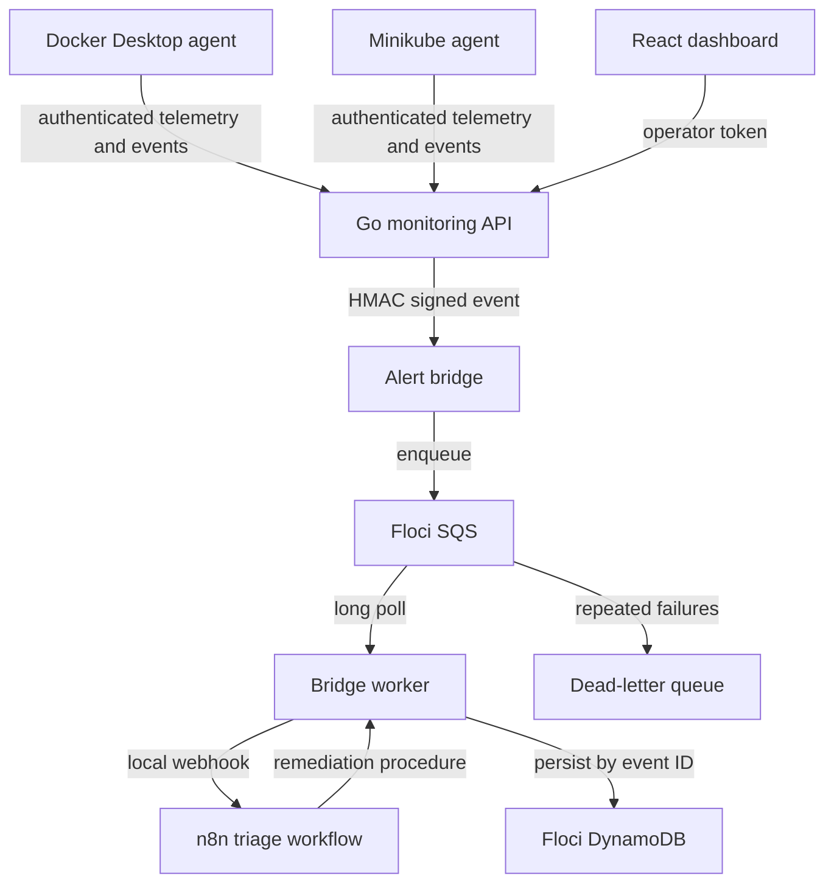

# CloudSentinels

A local observability and incident-response system for Docker Desktop Kubernetes and Minikube. Each cluster reports to a shared Go API using its own credential. Floci supplies SQS for alert delivery and DynamoDB for runbooks. n8n converts each event into diagnostic steps with its cluster and resource attached. The default stack runs on one computer without cloud accounts.

## Architecture



The ingress and worker run in the same bridge process. A successful API event acknowledgment means the bridge queued the alert. The worker acknowledges SQS after it stores the returned runbook. Delivery is at least once. Redelivery checks the event ID and original message fingerprint before invoking n8n again. A crash between webhook completion and storage can repeat a workflow execution. Runbooks are advisory, and cluster mutations are disabled in the local profile.

## Run on your PC

Install Docker with Compose v2 and Python 3.11 or newer. The first build downloads container images and dependencies. From the repository root:

```sh
python scripts/local.py up
python scripts/local.py smoke
```

Open the [dashboard](http://127.0.0.1:5173) and enter the generated `OPERATOR_KEY` from the ignored `.env.floci` file. The browser keeps it in tab memory. Open [n8n](http://127.0.0.1:5678) to inspect executions. Complete local owner setup on first use. The initializer imports and publishes the checked-in workflow. Edit the source workflow for repeatable changes.

The smoke check submits a labeled synthetic warning through the public Go agent route with the Minikube credential. It waits for the matching n8n runbook in Floci and prints it. This exercises the application path before either cluster is attached. A dashboard with zero attached clusters on first launch is expected.

| Component | Address or process | Responsibility |
|---|---|---|
| Dashboard | 127.0.0.1:5173 | Operator views and incident triage |
| Go API | 127.0.0.1:8082 | Agent identity, telemetry, alert decisions and command policy |
| Floci | 127.0.0.1:4566 | AWS-compatible SQS and DynamoDB APIs using local test credentials |
| Alert bridge | Internal, shares API network namespace | Verify signatures, enqueue events, retry delivery and persist runbooks |
| n8n | 127.0.0.1:5678 | Classify alerts and select diagnostic and approval steps |
| Cluster agents | One host process per context | Read nodes, pods, events and available resource metrics |

## Connect the two clusters

Install Go 1.23+, kubectl and Minikube. Enable Kubernetes in Docker Desktop settings. Create a separate Minikube profile and verify both contexts:

```sh
minikube start -p cloudsentinels-local --driver=docker
minikube -p cloudsentinels-local addons enable metrics-server
kubectl --context docker-desktop get nodes
kubectl --context cloudsentinels-local get nodes
```

Run each agent in its own terminal. Each invocation pins every kubectl call to its selected context, even if you later change the active context.

```sh
python scripts/local.py agent docker-desktop
```

```sh
python scripts/local.py agent cloudsentinels-local
```

The agents report every 30 seconds. Look for both cluster IDs in the dashboard. CPU and memory readings depend on each cluster exposing the Kubernetes metrics API. For example, an unhealthy deployment can produce a runbook with snapshot collection, rollout checks, and restart or rollback proposals requiring operator approval. The n8n flow never executes those proposals.

## Inspect and shut down

```sh
docker compose --env-file .env.floci logs --tail=50 bridge
docker compose --env-file .env.floci exec bridge python -c "from bridge import client; print(client('dynamodb').scan(TableName='runbooks',Limit=10)['Items'])"
python scripts/local.py down
```

Stop host agents with Ctrl+C. Docker volumes retain Floci data and n8n workflows across restarts. The Go API keeps its incident and telemetry views in process memory. Keep the stack on loopback. Cluster agents use your local kubeconfig. Floci's published endpoint accepts local test credentials.

## Repository consolidation

This repository combines the Go control plane, agent, locked frontend workspace and workflow from [cloudsentinels](https://github.com/ABHILASH9519/cloudsentinels) with dashboard error handling and severity/status components from [Cloud-Sentinels at f624719](https://github.com/ABHILASH9519/Cloud-Sentinels/tree/f6247199222a0ba77204eab14fa30ec4eb1415e4). The local profile has one Go API, one React dashboard and one n8n workflow. Historical AWS templates and PowerShell profiles are reference material. The default startup uses Floci and local operator authentication. Hosted AWS provisioning workflows are archived under `docs/legacy/workflows`.

## Verification

```sh
python -m unittest discover -s deploy/local
node deploy/automation/test-unified-workflow.mjs
go test ./...
python scripts/local.py smoke
```

[Floci project](https://github.com/floci-io/floci) · [Workflow definition](deploy/automation/n8n-cloudsentinels-unified.json) · [MIT license](LICENSE)

## Monitoring Floci itself

The `watch` service checks SQS queue availability, the dead-letter queue depth, and the status of the DynamoDB runbooks table every 30 seconds after each probe cycle. On a failure or recovery it records an event in a separate SQLite volume and sends it directly to the n8n workflow. This path can report a Floci outage while its SQS and DynamoDB endpoints are unavailable. Pending notifications retry when n8n recovers. Delivery is at least once.

Read generated notifications with `docker compose --env-file .env.floci logs -f watch`. Each includes the resource, observed state, and the procedure n8n selected. The observer shares the Docker host's failure domain. Whole-host outages require an external probe. Reconciliation that changes a hosted workload requires a configured target adapter.
