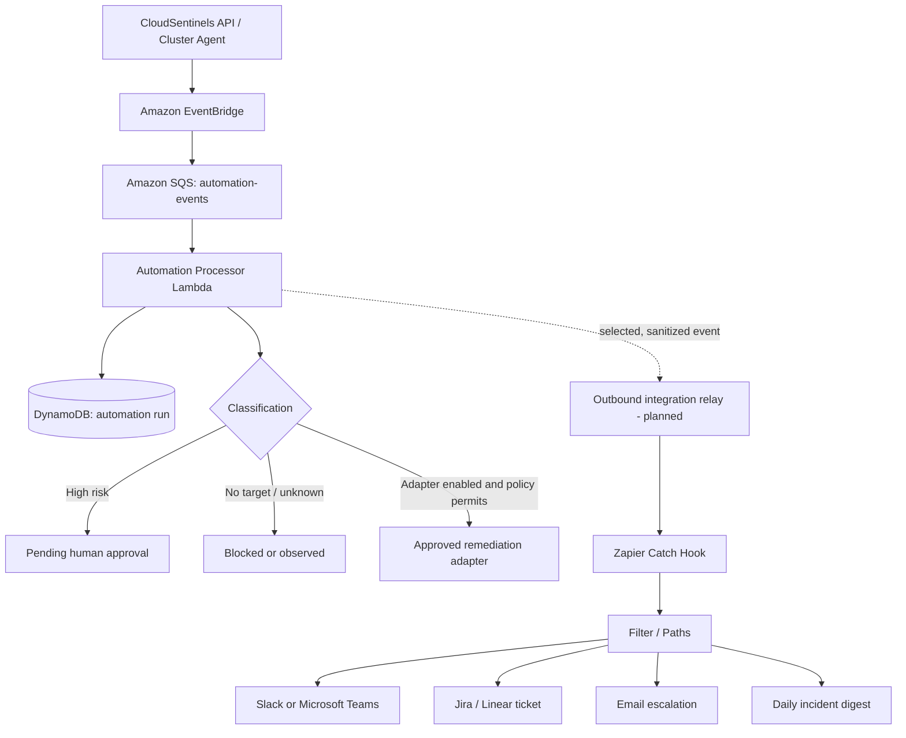

# CloudSentinels + Zapier automation blueprint

> Status: integration code and optional SAM infrastructure are committed. The relay is not deployed because the current AWS session is root and the scoped deployment identity is not available; the Zapier Catch Hook URL has not been provisioned.

## Responsibility boundary

- **CloudSentinels / AWS** owns event ingestion, event classification, idempotency, incident state, approvals, audit history, and any future Kubernetes remediation adapter.
- **Zapier** is an optional outbound workflow layer for notifications, ticketing, escalation, and reporting.
- A Zap failure must never block incident creation, event processing, or a recovery action.
- Zapier must never call Kubernetes directly or mark a recovery successful.

## Architecture



The optional relay is implemented in `deploy/aws/serverless/zapier-relay/index.js` and its conditional AWS resources are defined in `runtime-template.yaml`. It is created only when `ZapierWebhookSecretArn` is supplied. Do not configure Zapier to poll the core SQS queue: the Automation Processor is its consumer and owns that queue's retry semantics.

## Recommended Zaps

| Zap | Trigger | Filter / routing | Action |
|---|---|---|---|
| Critical incident | Catch Hook: `incident.created` or `automation.state_changed` | severity = critical | Notify on-call Slack/Teams channel and email |
| Ticket sync | Catch Hook: `incident.created` | severity in high/critical; dedupe by `eventId` | Create Jira/Linear issue; save external ticket ID in Zapier storage or ticket fields |
| Approval request | Catch Hook: `automation.approval_required` | approval status = pending | Notify approver with CloudSentinels deep link; approval must happen in CloudSentinels |
| Recovery result | Catch Hook: `automation.recovery_verified` | `recoveryVerified = true` only | Post resolved update and close/update matching ticket |
| Daily digest | Schedule by Zapier | query/report source is a trusted CloudSentinels report endpoint | Send summary email or Teams post |

Do not send every raw metric to Jira. Alert thresholds and deduplication belong in CloudSentinels; Zapier routes already-qualified state changes.

## Sanitized webhook contract

The relay sends only the following allow-listed fields (unknown fields are dropped):

```json
{
  "schemaVersion": "1",
  "eventId": "evt_01J...",
  "eventType": "automation.state_changed",
  "occurredAt": "2026-11-10T08:00:00.000Z",
  "severity": "critical",
  "incidentId": "inc_...",
  "clusterRef": "cluster-prod-01",
  "status": "PENDING_APPROVAL",
  "recommendedAction": "rollback-deployment",
  "requiresApproval": true,
  "recoveryVerified": false,
  "dashboardUrl": "https://<cloudsentinels-dashboard>/incidents/<incident-id>"
}
```

Use opaque cluster references, not kubeconfig, API-server addresses, pod logs, environment variables, credentials, JWTs, or raw user records. Only emit `automation.recovery_verified` after the AWS-side adapter has independently checked the post-action cluster state.

## Secure connection pattern

1. In Zapier, create a Catch Hook trigger and copy its generated URL.
2. Store that URL in AWS Secrets Manager as a secret named for this integration. Do not put it in Git, CloudFormation parameters, frontend variables, or chat messages.
3. Deploy the optional SAM relay by supplying `ZapierWebhookSecretArn`; the Lambda is granted `secretsmanager:GetSecretValue` only on that secret and receives events through its own EventBridge rule and SQS queue.
4. Relay only an allow-listed payload; sign requests with an HMAC secret and include a timestamp and event ID. Verify signature and reject stale/replayed requests if the receiving endpoint supports verification; otherwise use a dedicated authenticated relay endpoint in front of Zapier.
5. Use bounded retries, exponential backoff, an SQS delivery DLQ, and idempotency keyed by `eventId`. Treat Zapier's successful webhook receipt as delivery, not proof that every downstream Zap action succeeded.
6. Keep the Zap disabled until the test payload has been validated and the destination channel/project is confirmed.

**Important:** Zapier Catch Hook URLs are bearer secrets. Anyone who obtains one may be able to trigger the Zap. Rotate it immediately if exposed.

## Current AWS resources and readiness

Region: `ap-south-1`

- EventBridge bus: `cloudsentinels-domain-events`
- Core event queue: `cloudsentinels-automation-events`
- Processor: `cloudsentinels-runtime-AutomationProcessor-UDoJ0RbU1Fd8`
- Processor DLQ: `cloudsentinels-automation-dlq`
- Event delivery DLQ: `cloudsentinels-automation-delivery-dlq`
- State table: `cloudsentinels-core-app`

The EventBridge → SQS → Automation Processor path is provisioned. The processor records classifications and deliberately does not execute Kubernetes API calls until a cluster target, adapter, scoped RBAC, and approval policy are configured. The Zapier relay, webhook secret, and Zap workflows are not yet provisioned.

## Acceptance checks before enabling production Zaps

- [ ] Relay receives only approved event types and allow-listed fields.
- [ ] Secrets Manager secret is populated outside source control.
- [ ] Duplicate EventBridge deliveries do not create duplicate tickets or repeated alerts.
- [ ] A Zapier outage leaves CloudSentinels processing healthy and queues delivery for retry.
- [ ] DLQ alarms and replay procedure are documented.
- [ ] High-risk remediation remains pending until a CloudSentinels approval is recorded.
- [ ] A recovery notification is emitted only after the Kubernetes adapter verifies the resulting state.


## Provisioning the webhook secret and deploying

Create a private local JSON file (never commit it) with this exact shape:

```json
{
  "webhookUrl": "https://hooks.zapier.com/hooks/catch/REPLACE_WITH_YOUR_HOOK/",
  "signingSecret": "REPLACE_WITH_A_RANDOM_SECRET_OF_AT_LEAST_32_CHARACTERS"
}
```

Create the secret in `ap-south-1` using a dedicated deployment identity:

```powershell
aws secretsmanager create-secret --name cloudsentinels/zapier/webhook --secret-string file://zapier-secret.json --region ap-south-1
```

Use the returned secret ARN as `ZapierWebhookSecretArn` in the SAM deployment. If the parameter is omitted or empty, the relay resources remain disabled and the rest of CloudSentinels deploys unchanged. Do not print the secret value or put the webhook URL in GitHub Actions logs.

After deployment, send a synthetic low-risk test incident and verify: EventBridge matched it, the dedicated relay queue received it, the Lambda logged an accepted webhook response, and the Zap performed the expected destination action. Confirm duplicate event IDs do not create duplicate tickets (use Zapier-side dedupe keyed by `eventId`).

The HMAC headers are provided for downstream verification. A Zapier Catch Hook does not automatically validate this signature; if signature verification is required, add a verification step or place an authenticated verifier endpoint in front of the Zap. Keep the Catch Hook URL private regardless.
