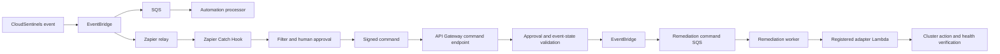

# Zapier-triggered AWS remediation workflow

This integration makes Zapier the approval/orchestration layer and AWS the execution layer. It is deliberately fail-closed: a Zap can request an action only for an existing event that is awaiting approval, and the AWS worker is created only when a separate remediation adapter and explicit execution opt-in are configured.

## Event and command flow



The existing Zapier relay sends allow-listed CloudSentinels events to a Zapier Catch Hook. The new command endpoint handles the reverse direction: Zapier sends a signed approval command to AWS. The worker invokes a separately deployed adapter Lambda; it does not contain Kubernetes credentials or bypass the adapter's own RBAC and policy checks.

## AWS configuration

Create a Secrets Manager secret in the same AWS region as the runtime stack (ap-south-1) with this JSON shape:

```json
{
  "signingSecret": "replace-with-a-random-secret-of-at-least-32-characters"
}
```

Use a different secret from the outbound relay secret where practical. Do not commit the secret or paste it into GitHub.

Set the following CloudFormation parameters when deploying the runtime stack:

| Parameter | Required for | Value |
|---|---|---|
| `ZapierCommandSecretArn` | Signed Zapier command endpoint | ARN of the secret above |
| `RemediationAdapterFunctionArn` | Worker dispatch | ARN of a separately deployed adapter Lambda |
| `RemediationExecutionEnabled` | Live dispatch | `true` only after adapter testing and approval |

The default for `RemediationExecutionEnabled` is `false`. The worker Lambda is not provisioned unless all three conditions are met: command secret configured, adapter ARN supplied, and execution explicitly enabled. If the adapter is not configured, commands can be accepted and placed on the command queue, but no cluster action is run.

## Configure the Zap in Zapier

The incoming relay uses **Webhooks by Zapier → Catch Hook**. Zapier's Catch Hook trigger and outbound webhook action are documented in the official guides:
- [Trigger Zaps from webhooks](https://help.zapier.com/hc/en-us/articles/8496288690317-Trigger-Zap-workflows-from-webhooks)
- [Send webhooks in Zaps](https://help.zapier.com/hc/en-us/articles/8496326446989-Send-webhooks-in-Zap-workflows)
- [Use JavaScript code in Zaps](https://help.zapier.com/hc/en-us/articles/8496310939021-Use-JavaScript-code-in-Zap-workflows)

1. Create a Zap with **Webhooks by Zapier → Catch Hook** as its trigger. Copy the generated hook URL into the outbound relay secret used by the AWS runtime.
2. Test the trigger with a CloudSentinels event. Use the fields `eventId`, `eventType`, `requiresApproval`, `recommendedAction`, and `clusterRef` from the relay payload.
3. Add a Filter step. Continue only when `requiresApproval` is true and `recommendedAction` is present. Add event-type/severity conditions appropriate to your operational policy.
4. Add a human approval step (for example, your organization's approved approval app). Do not treat a Zapier Filter or a successful webhook delivery as human approval.
5. Add **Code by Zapier → Run JavaScript** after the approval step. Provide these Input Data fields:
   - `eventId`: event ID from the Catch Hook
   - `action`: `recommendedAction` from the Catch Hook
   - `approvedBy`: identity/name from the approval result
   - `signingSecret`: the same value stored in the AWS command secret. Restrict access to this Zap and its run history.
6. Use this code to create a stable command ID and sign the exact request body:

```javascript
const crypto = require("crypto");

const command = {
  eventId: inputData.eventId,
  commandId: crypto
    .createHash("sha256")
    .update(inputData.eventId + ":" + inputData.action)
    .digest("hex"),
  action: inputData.action,
  approvalStatus: "approved",
  approvedBy: inputData.approvedBy,
};

const body = JSON.stringify(command);
const timestamp = Math.floor(Date.now() / 1000).toString();
const signature = crypto
  .createHmac("sha256", inputData.signingSecret)
  .update(timestamp + "." + body)
  .digest("hex");

return { body, timestamp, signature };
```

7. Add **Webhooks by Zapier → Custom Request**:
   - Method: `POST`
   - URL: `<ApiBaseUrl>/automation/commands` (use the deployed `ApiBaseUrl` stack output)
   - Headers:
     - `Content-Type: application/json`
     - `X-CloudSentinels-Timestamp: <timestamp from Code step>`
     - `X-CloudSentinels-Signature: sha256=<signature from Code step>`
   - Data/body: the exact `body` string returned by the Code step.
8. A `202` response means the approval command was accepted and queued. It does **not** mean a pod was restarted or a service recovered.

## Adapter contract

The worker invokes the configured adapter Lambda synchronously with a JSON payload containing:

- `schemaVersion`
- `commandId` (stable idempotency key)
- `eventId`
- `action`
- `clusterName`
- `approvedBy`
- `approvedAt`

The adapter must validate the cluster and resource target, enforce least-privilege Kubernetes RBAC, reject unsupported actions, and be idempotent by `commandId`. It must return JSON in this shape:

```json
{
  "accepted": true,
  "executionId": "adapter-operation-id",
  "recoveryVerified": false
}
```

Set `recoveryVerified` to true only after an independent health check confirms recovery. The worker records `ACTION_SUBMITTED_UNVERIFIED` otherwise, and `RECOVERY_VERIFIED` only when the adapter explicitly confirms it. Failed invocations are returned to SQS for retry and eventually move to the configured dead-letter queue.

## Safety boundaries and current status

- The command endpoint verifies a timestamped HMAC-SHA256 signature, rejects stale signatures, checks the event's pending-approval state, and requires the action to match the stored recommendation.
- A command cannot target an event without a cluster target or bypass the `requiresApproval` flag.
- Repeated requests use a stable command ID. The adapter must also deduplicate by that ID because SQS and EventBridge delivery are at-least-once.
- No generic shell execution, arbitrary Kubernetes command, or user-supplied Lambda ARN is accepted.
- The adapter is a separate deployment boundary. Until a real adapter is deployed, configured, and tested against a non-production EKS cluster, **live self-healing is not enabled**.
